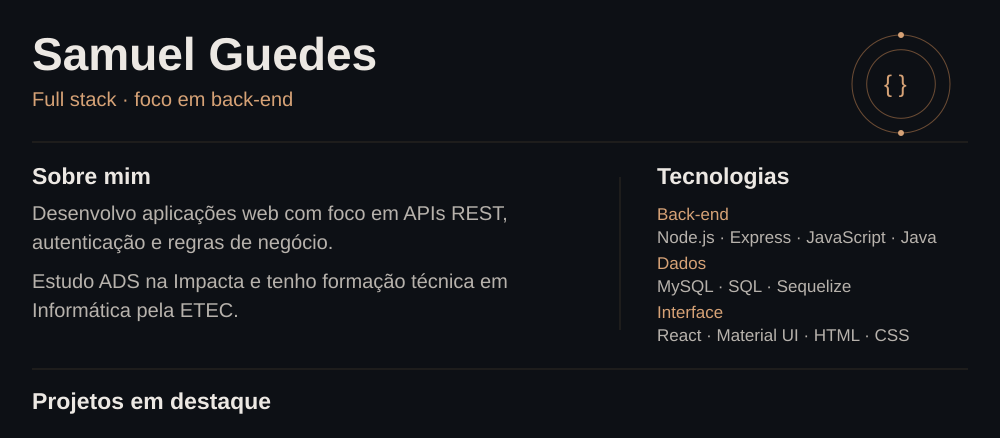
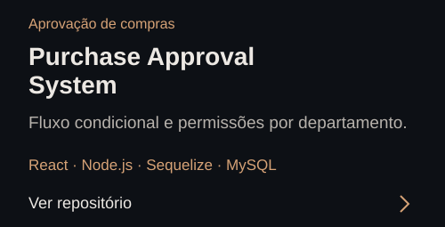
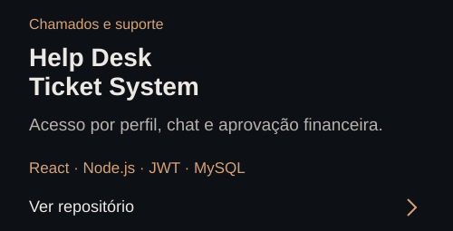

<!-- Original compact profile. Regenerate: python3 scripts/build_profile.py -->

<a href="https://portifolio-samuel-svm7.vercel.app/"><picture><source media="(max-width:600px)" srcset="./assets/compact-overview-mobile.svg"></picture></a><a href="https://github.com/samuelguedesss/purchase-approval-system"><picture><source media="(max-width:600px)" srcset="./assets/compact-purchase-mobile.svg"></picture></a><a href="https://github.com/samuelguedesss/helpdesk-ticket-system"><picture><source media="(max-width:600px)" srcset="./assets/compact-helpdesk-mobile.svg"></picture></a><a href="https://portifolio-samuel-svm7.vercel.app/"><picture><source media="(max-width:600px)" srcset="./assets/link-portfolio-mobile.svg"></picture></a><a href="https://www.linkedin.com/in/samuel-fguedes/"><picture><source media="(max-width:600px)" srcset="./assets/link-linkedin-mobile.svg"></picture></a><a href="mailto:samuelguedes473@gmail.com"><picture><source media="(max-width:600px)" srcset="./assets/link-email-mobile.svg"></picture></a>

