<h3><code>samuel@github ~ $ whoami</code></h3>

  
  <a href="https://portifolio-samuel-svm7.vercel.app/"><picture><source media="(max-width:600px)" srcset="./assets/info-card-mobile.svg"></picture></a>

 

<h3><code>samuel@github ~ $ ./contributions.sh</code></h3>

  

<code>samuel@github ~ $ cat stack.md</code>

 

| Categoria | Tecnologias |
|---|---|
| **Linguagens** | JavaScript, Java, SQL, HTML, CSS |
| **Back-end** | Node.js, Express, APIs REST |
| **Autenticação e acesso** | JWT, RBAC, permissões por perfil |
| **Banco de dados** | MySQL, Sequelize, modelagem de dados |
| **Front-end** | React, Material UI |
| **Ferramentas** | Git, GitHub, Figma |

<code>samuel@github ~ $ ls projects/</code>

 

| Projeto | O que construí |
|---|---|
| [Purchase Approval System](https://github.com/samuelguedesss/purchase-approval-system) | Aprovações condicionais, permissões por departamento e autenticação JWT. |
| [Help Desk Ticket System](https://github.com/samuelguedesss/helpdesk-ticket-system) | Chamados, controle de acesso, chat por polling HTTP e aprovação financeira. |

 

<code>samuel@github ~ $ contact --all</code>

[Portfólio](https://portifolio-samuel-svm7.vercel.app/) · [LinkedIn](https://www.linkedin.com/in/samuel-fguedes/) · [E-mail](mailto:samuelguedes473@gmail.com)

