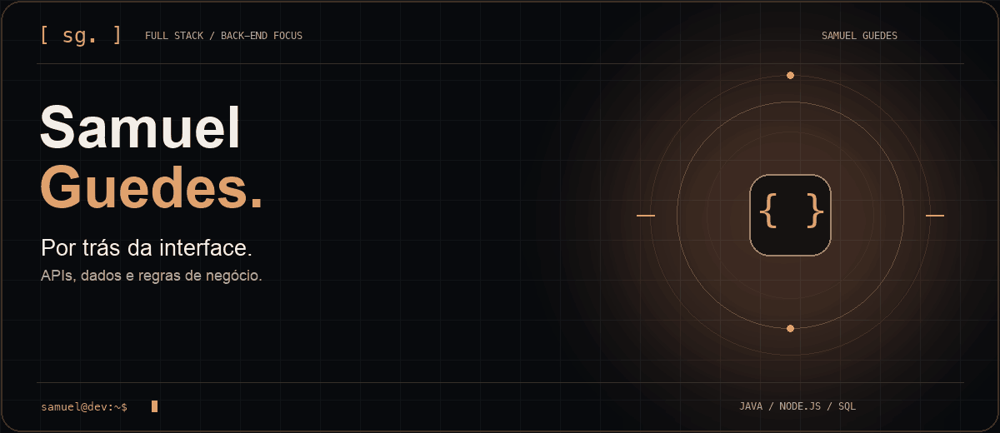
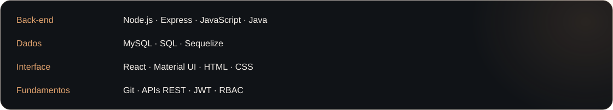
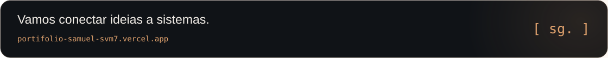

<a href="https://portifolio-samuel-svm7.vercel.app/">
  <picture>
    <source media="(prefers-reduced-motion: reduce)" srcset="./assets/profile-cover.png">
    
  </picture>
</a>

  <a href="https://portifolio-samuel-svm7.vercel.app/"><strong>Portfólio</strong></a>
  &nbsp; / &nbsp;
  <a href="https://www.linkedin.com/in/samuel-fguedes/">LinkedIn</a>
  &nbsp; / &nbsp;
  <a href="mailto:samuelguedes473@gmail.com">E-mail</a>

### Por trás da interface

Sou Samuel Guedes, desenvolvedor full stack com foco em **back-end, APIs REST e bancos de dados**. Nos meus projetos, conecto interfaces a regras de negócio: quem pode acessar, como uma aprovação avança e como os dados chegam à pessoa certa.

Estudo **Análise e Desenvolvimento de Sistemas na Impacta** e tenho formação técnica em **Informática pela ETEC**. Sigo evoluindo com estudo, projetos pessoais e prática.

### Sistemas em destaque

<a href="https://github.com/samuelguedesss/purchase-approval-system"><picture><source media="(prefers-reduced-motion: reduce)" srcset="./assets/purchase-approval.svg"></picture></a>
<a href="https://github.com/samuelguedesss/helpdesk-ticket-system"><picture><source media="(prefers-reduced-motion: reduce)" srcset="./assets/helpdesk.svg"></picture></a>

<strong>Explorar a lógica dos projetos</strong>

#### [Purchase Approval System](https://github.com/samuelguedesss/purchase-approval-system)

Uma requisição passa pelo coordenador do departamento, pelo gerente geral quando necessário e pelo financeiro. O fluxo muda conforme o valor da compra; as permissões e o departamento determinam o que cada pessoa pode ver e aprovar.

`JWT` · `RBAC` · `Aprovação condicional` · `Sequelize` · `MySQL`

#### [Help Desk Ticket System](https://github.com/samuelguedesss/helpdesk-ticket-system)

Centraliza abertura, acompanhamento e resolução de chamados. Cada perfil tem sua visão do sistema, com chat por chamado, notificações e aprovação financeira para solicitações que exigem validação. O chat consulta novas mensagens por polling HTTP.

`APIs REST` · `RBAC` · `Chat e notificações` · `Upload de anexos` · `MySQL`

### Ferramentas que conectam tudo

### O que estou construindo

- **Regras de negócio claras:** fluxos de aprovação e permissões por perfil.
- **Aplicações completas:** da modelagem dos dados à interface em React.
- **Base técnica:** aprofundando Java, JavaScript e SQL.

