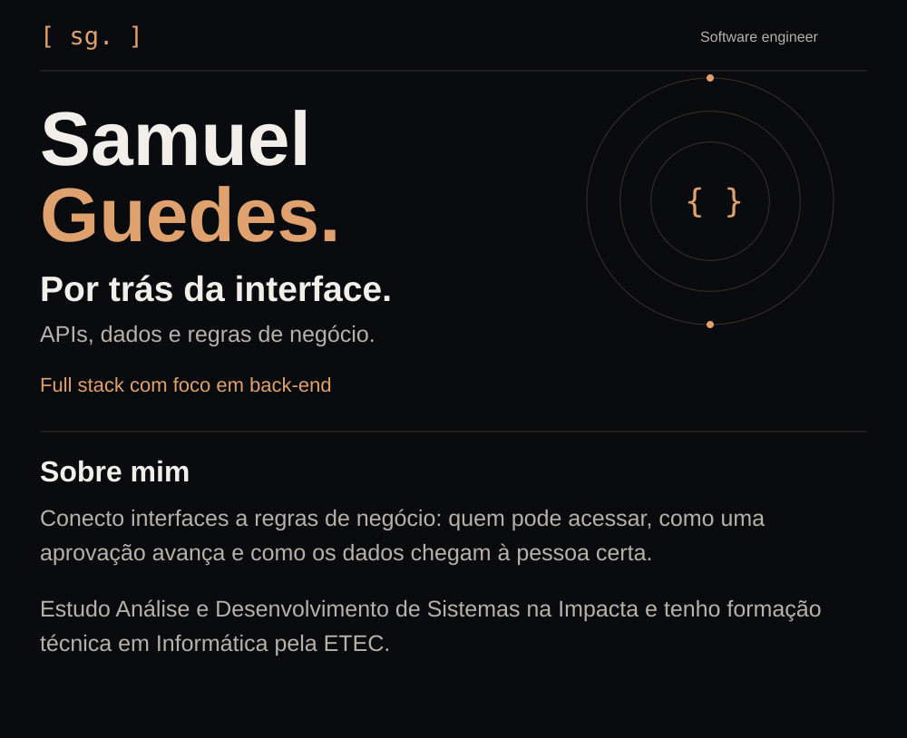
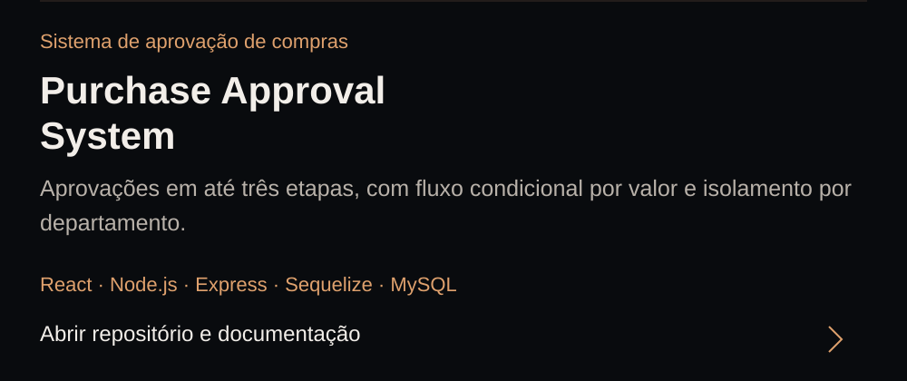
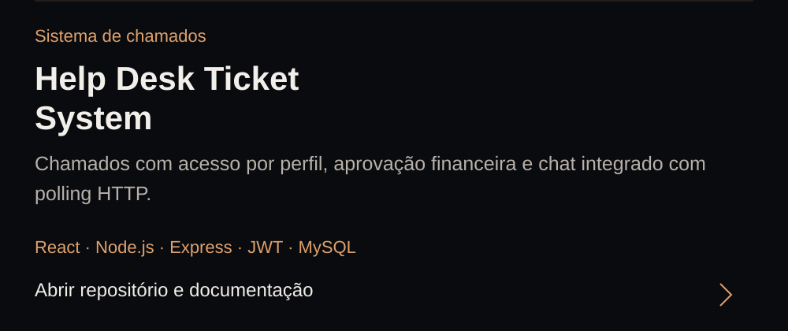
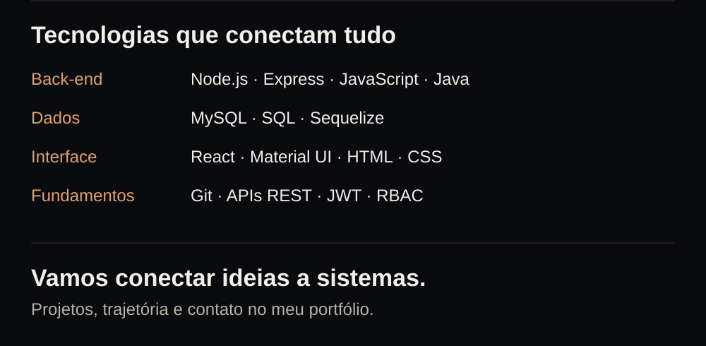
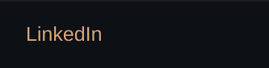
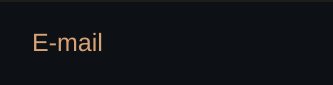

<!-- Original, continuous artwork. Regenerate: python3 scripts/build_profile.py -->

<a href="https://portifolio-samuel-svm7.vercel.app/"><picture><source media="(max-width: 600px)" srcset="./assets/profile-intro-mobile.svg"></picture></a><a href="https://github.com/samuelguedesss/purchase-approval-system"><picture><source media="(max-width: 600px)" srcset="./assets/profile-purchase-mobile.svg"></picture></a><a href="https://github.com/samuelguedesss/helpdesk-ticket-system"><picture><source media="(max-width: 600px)" srcset="./assets/profile-helpdesk-mobile.svg"></picture></a><a href="https://portifolio-samuel-svm7.vercel.app/"><picture><source media="(max-width: 600px)" srcset="./assets/profile-stack-mobile.svg"></picture></a>

